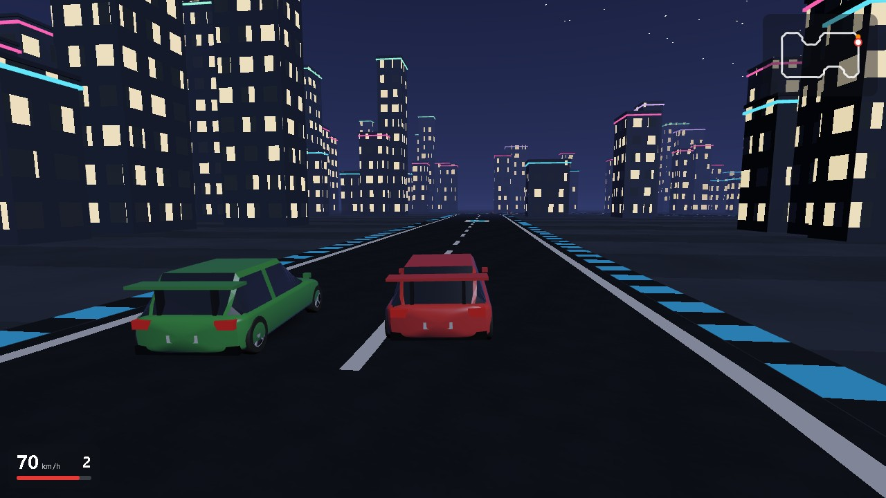

# PlayForge

Describe a game in one sentence and play it in your browser a second later.

**Play:** https://siddhanth-mani.github.io/playforge/



> “make a racing game in Fiji with 3 laps and collect 10 coconuts”
> “a night race through Suva in a red rally car, hard”
> “platformer in the rainforest, collect 30 shells under 2 minutes”
> “space shooter with a boss fight, score 5000 points”

Each sentence becomes a playable game with a map, a vehicle or hero, rivals and missions. You can change any of it in the editor (car, colour, place, layout, laps, difficulty, missions) and share it as a link. Whoever opens the link can play it and remix it into their own version.

## What's in it

**Three game engines**, written from scratch with no game library:

- **Racing, in 3D.** A WebGL2 renderer written for this game (no Three.js or other library) draws modelled cars with glass, paint reflections, spinning and steering wheels, brake lights, body roll and dive, contact shadows and skid marks, from a chase camera. Every place gets its own 3D scenery: palms, buildings with lit windows, cane fields, rainforest, volcanic rock and lava, coral and crystals. Browsers without WebGL2 get the original top-down 2D view. The cars run on real vehicle physics (see below). Tracks come from a seed in five layouts: coastal loop, oval, figure eight, mountain pass and city blocks. AI rivals follow the racing line with pure-pursuit steering, brake for corners using each corner's grip-limited speed, change lanes around cars and obstacles, and get mild catch-up help. The race has laps, positions, coconuts to collect, boost pads, a minimap and a speedometer with gear and revs. Vehicles: hatchback, rally car, pickup, island bus and scooter.
- **Platformer**, side-scrolling. Levels are generated from a seed in three styles (hills, island hops, caves). The generator only places gaps and steps that fit inside the jump arc, and wide gaps get a stepping-stone platform. You get coyote time, jump buffering, variable jump height, stompable enemies, a checkpoint and hearts.
- **Arcade shooter**, vertical. Enemy waves come in five patterns (line, snake, divers, turrets, splitting asteroids), with power-ups (spread, rapid fire, shield, extra life), warned lightning strikes in the storm layout, and a boss with three attack patterns and a second phase.

**Eight places**, each with its own colours and scenery: Fiji coast, Suva, the cane fields, rainforest, volcano, the city at night, coral reef and outer space.

**Missions**, four per genre, such as finish position, time limit, coconuts collected, hits taken, shells, accuracy, lives lost and defeating the boss. They are shown before you start, tracked live in the HUD and ticked off on the results screen, and your best result is kept per game.

**Works on phones.** On touch screens it shows on-screen pedals and arrows; in the shooter you drag to fly. It also adapts to safe areas and uses iOS-style sheets, grouped lists, segmented controls and switches. It follows the system light or dark setting.

## Car physics

Each car is simulated as a dynamic bicycle model in metres and newtons, with two substeps per 60 Hz frame:

- **Tyres:** lateral force from the slip angle with a Pacejka-style curve, `mu * load * sin(1.9 * atan(10 * slip))`. Grip peaks near 6 degrees of slip and falls away after it, so cars can slide.
- **Load transfer:** braking moves weight onto the front axle and accelerating moves it onto the rear, using the car's centre-of-mass height and wheelbase.
- **Friction circle per axle:** grip used for driving or braking is not available for cornering. Traction control and ABS trim the force so the tyres keep enough grip to steer.
- **Drivetrain and resistance:** front-, rear- or all-wheel drive; engine power with a launch limit; a gearbox that shifts at 6,400 rpm; aerodynamic drag and rolling resistance. Drag is solved from each car's power so it reaches its rated top speed.
- **Brakes and stability:** brakes split by axle load (EBD), plus stability control (ESC) that brakes single wheels when the car yaws more than the steering asks for, so trail-braking does not spin it.
- **Surfaces and contact:** grass has 62% of the grip of tarmac and four times the rolling resistance. Contact with other cars and obstacles is kept simple: circle collisions push cars apart and scrub off speed.

| Car | Mass | Power | Drive | 0-100 km/h | 100-0 km/h | Top speed |
| --- | --- | --- | --- | --- | --- | --- |
| Hatchback | 1,150 kg | 156 kW | front | 5.7 s | 37 m | 180 km/h |
| Rally car | 1,250 kg | 209 kW | all | 3.6 s | 35 m | 194 km/h |
| Pickup | 1,850 kg | 207 kW | rear | 5.6 s | 39 m | 173 km/h |
| Island bus | 4,200 kg | 218 kW | rear | 10.4 s | 42 m | 158 km/h |
| Scooter | 260 kg | 31 kW | rear | 4.7 s | 36 m | 169 km/h |

These figures come out of the simulation; they are not set directly. A test checks them against real-world ranges.

## How a sentence becomes a game

A game is a small JSON spec:

```json
{ "title": "Coral Coast Rally", "genre": "racing", "theme": "fiji-coast", "difficulty": "normal",
  "player": { "kind": "rally", "color": "#e53935" },
  "map": { "layout": "coastal-loop", "seed": 1970, "length": 2 },
  "laps": 3, "rivals": 3,
  "missions": [{ "type": "position", "target": 1 }, { "type": "collect", "target": 12 }] }
```

Two designers can write one:

1. **Built-in (default).** [`src/prompt.js`](src/prompt.js) reads the sentence on your device: genre words, place names (Nadi, Suva, Lautoka, Taveuni and more), vehicles, colours, numbers written as digits or words ("three laps"), difficulty, time limits, "called …" titles and goals. It needs no network and no key. The same sentence always gives the same game, because the map seed is a hash of the text.
2. **Gemini (optional).** Paste your own Google Gemini API key in settings and Gemini designs the game instead, with the built-in designer as the fallback if anything goes wrong. The key stays in your browser's local storage and is sent only to Google, in a request header rather than the URL.

Whichever designer writes the spec, it then goes through `normalize()` in [`src/spec.js`](src/spec.js). That one gate clamps every number, rejects unknown values, removes duplicate or wrong-genre missions and strips control characters. The engines only ever see a valid spec, so an odd AI reply or a hand-edited link cannot break a game.

## Share links

The spec is compressed (deflate, using the browser's `CompressionStream`) and put in the URL fragment: `#/play/<code>`. A typical link is under 300 characters. There is no server and no database: the link *is* the game, so it keeps working as long as the page is online.

Links can come from anyone, so all text from a spec is inserted with `textContent`, never `innerHTML`. The page's Content Security Policy also only allows scripts from the site itself and network requests to the Gemini API.

## Code

| File | What it does |
| --- | --- |
| [`src/spec.js`](src/spec.js) | Genres, places, vehicles, layouts and missions; `normalize()`; share-code encode and decode; seeded random. |
| [`src/prompt.js`](src/prompt.js) | Sentence-to-spec parser. |
| [`src/ai.js`](src/ai.js) | Optional Gemini designer. |
| [`src/engine/racing.js`](src/engine/racing.js) | Track generation (Catmull-Rom spline, resampled every 10 px) with corner speed limits, vehicle physics, AI, laps, the 2D view and the HUD overlay. |
| [`src/engine/racing3d.js`](src/engine/racing3d.js) | WebGL2 renderer: procedural car, wheel, scenery and track meshes, shaders for paint, glass, road and water, chase camera, skid marks. |
| [`src/engine/platformer.js`](src/engine/platformer.js) | Level generator, tile collision, enemies and rendering. |
| [`src/engine/shooter.js`](src/engine/shooter.js) | Waves, boss, power-ups, storm and rendering. |
| [`src/missions.js`](src/missions.js) | Live and final mission scoring. |
| [`src/audio.js`](src/audio.js) | Sound effects synthesised with Web Audio, so there are no audio files. |
| [`src/app.js`](src/app.js) | Interface: home, play, editor, sharing and saved games. |

Each engine exposes `create`, `step`, `result`, `hud`, `draw` and `thumb`. The first four never touch the DOM, so the tests run whole games in Node at a fixed 60 steps per second. The 3D view only reads the race state, so physics and AI are tested the same way whether a game is shown in 3D or 2D.

## Tests

```
npm test        # Node 18 or newer, nothing to install
```

The 27 tests cover:

- spec validation, including hostile share links and prototype pollution;
- share-code round trips;
- the parser on every example sentence;
- the Gemini client against a fake `fetch` (key placement, junk replies, error messages);
- car physics against real-world figures: 0-100 km/h time, braking distance from 100 km/h, top speed for every car, and full-lock cornering staying within the tyres' grip without spinning;
- full simulated games:
  - an autopiloted race finishing on all five layouts;
  - a bot finishing 45 generated platformer levels;
  - the boss being beaten on all three shooter layouts;
  - a shooter player who never moves losing.

GitHub Actions runs them on every push.

## Running locally

```
python -m http.server 8000     # then open http://localhost:8000
```

Any static file server works. The app has no build step and no dependencies.

## Licence

MIT
